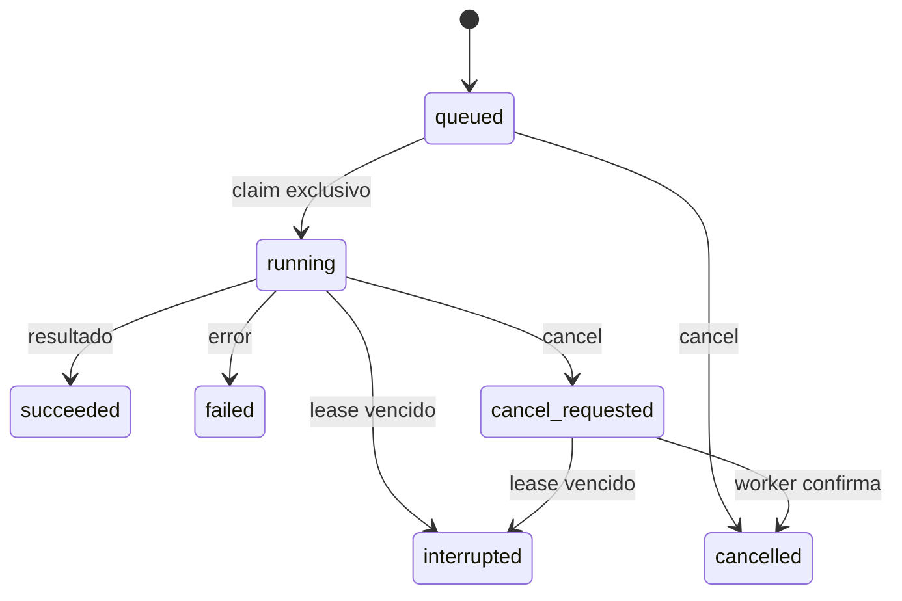

# Acceso y límite del agente

## Autenticación y superficie expuesta

El modo stdio se autentica mediante usuario/sesión/ACL del sistema y el permiso
de iniciar el proceso y leer su configuración. `state_dir` se crea 0700;
JSON/SQLite/locks se crean 0600. Stdio sin allowlist es administrativo local.
El perfil HTTP privado es opt-in y exige además un bearer efímero entregado por
pipe; sólo escucha en loopback. No hay token hardcoded, listener público, login
web u OAuth implementado. Ver [remote-plan.md](remote-plan.md).

El usuario del host/control plane debe ser confiable: la política de capacidades
no aísla procesos hostiles del mismo usuario. En Oracle, SSH futuro puede
autenticar con credenciales existentes y un comando fijo. `ssh-plan` sólo lo
renderiza; la conexión/inicio remoto y cualquier configuración de autenticación
requieren autorización específica. No conectar el servidor a un gateway público
genérico sin la autenticación/autorización y el aislamiento adicionales.

Esto **no es una integración conectada directamente a ChatGPT**. No se entrega
endpoint HTTPS, túnel configurado, plugin conectado ni prueba de conexión desde
ChatGPT. La [documentación oficial actual](https://developers.openai.com/plugins/deploy/connect-chatgpt)
admite URL HTTPS o Secure MCP Tunnel; el túnel puede envolver un servidor stdio.
El siguiente corte deberá elegir y probar ese mecanismo privado o integrar
HTTPS/OAuth con autenticación y descubrimiento correspondientes,
validación de Origin/sesión, autorización por operación y límites de solicitudes.
No se debe convertir este proceso en un endpoint público anónimo. SSH stdio
puede servir a clientes locales compatibles, pero no configura por sí solo una
conexión de ChatGPT. Ninguna de esas credenciales o conexiones se creó aquí.

Kubernetes autentica con el kubeconfig y contexto **explícitos** de la instancia;
nunca se usa el contexto actual de forma implícita. El adapter usa listas de args,
sin `shell=True`, comandos o flags procedentes de la app. GET/LIST/WATCH y
create/replace/delete apuntan a tipos y rutas API fijos. DELETE incluye UID y
resourceVersion. No tiene operación de exec, Secret, Node, PV, RBAC ni Namespace
delete. Los errores públicos suprimen stdout/stderr de kubectl para evitar que
incluyan configuraciones o valores. La causa precisa se investiga localmente con
herramientas del operador, evitando imprimir Secrets.

El manifest [controller-rbac.yaml](../bootstrap/controller-rbac.yaml) es una
propuesta de grants para revisar/aplicar después, no una credencial creada.
Permite crear namespaces y gestionar tipos definidos en el cluster. Kubernetes
RBAC estándar no restringe esos grants por labels/prefijo de namespace; no es
aislamiento contra un controller comprometido ni multi-tenancy. El control plane
debe ser confiable en un cluster personal dedicado. El agente futuro no recibe
este kubeconfig ni objetos Python del control plane. Secrets TLS y del registry
los gestiona el operador; Traefik tiene sus propios grants de lectura necesarios.

Además de labels/rol/nombres fijos, la release fija el UID del namespace y el
ledger fija UIDs de PVC. Un PVC ajeno, reemplazado o con ownerReferences se rechaza.
La metadata utiliza comparación con su UID/resourceVersion originalmente leído.
No hay garantía contra un administrador de cluster que falsifique propiedad o
modifique recursos concurrentemente. El lock sólo coordina procesos que usan el
mismo `state_dir`; la unicidad de rutas no es una transacción entre varios
controllers. El archivo de vínculo de estado evita reutilización accidental de
instancia/backend/contexto, no cambios dentro de un kubeconfig confiable.

Por defecto no hay rutas, proxy Service ClusterIP ni ServiceLB/NodePort de apps.
Para habilitar rutas hacen falta `routing_enabled`, allowlist `route_cidrs` y TLS
local (`tls_secret`). HTTP es opt-in `allow_http`, útil sólo para prueba privada.
CIDRs públicos requieren además `allow_public_routes`; no es autenticación de
usuario. Sólo redes privadas/loopback se aceptan sin ese opt-in. Ninguno de estos
flags modifica DNS, firewall, security lists de OCI o puertos del host. Mantener
el tráfico privado hasta diseñar acceso y TLS; no confiar en headers
X-Forwarded-For de un proxy no autenticado.

Pods no root, sin tokens de ServiceAccount, sin capabilities, seccomp
RuntimeDefault, rootfs read-only y Pod Security restricted. NetworkPolicy permite
entrada desde los Pods Traefik del namespace de proxy y salida DNS; el resto de
salida necesita CIDRs explícitos. Esto requiere que el CNI aplique NetworkPolicy
(K3s incorpora su controlador por defecto). Un port-forward autorizado al Pod
puede evitar la policy; lo controla RBAC del operador. La policy no es un filtro
de información sensible que una app decida publicar.

Logs están deshabilitados salvo `log_safe_apps` declarado por el operador después
de verificar scrub upstream. Hay límite 32 KiB / 500 líneas y redacción común de
Authorization, tokens, passwords y URLs con credenciales. **No se promete detectar
secretos arbitrarios por valor**: las referencias no revelan ese valor al control
plane. Nunca habilitar logs de una app que imprime Secrets. No se loguean specs,
requests, manifiestos ni errores raw del cluster como telemetría de plataforma.

Para clientes remotos, `mcp --allow-app ...` y `mcp-http` usan la misma política:
read permite inventory/status/task_status/result; operate agrega operaciones de
runtime/tareas y logs previamente habilitados. volumes_delete necesita un permiso
adicional. La app de cada task_id se verifica antes de lectura/cancelación. El
catálogo filtrado no es la única defensa: cada tools/call comprueba autorización.
Stdio sin allowlist sigue siendo administrativo local y requiere un caller de
confianza. El HTTP privado no sustituye el contrato OAuth MCP de ChatGPT.

## Contrato de tareas

MCP publica cuatro operaciones asíncronas, además de las directas:

| Operación | Entrada | Salida |
| --- | --- | --- |
| `submit` | `request: {app_id, kind}`, `idempotency_key` | task_id, estado, timestamps |
| `task_status` | `task_id` | Estado persistido sin resultado |
| `result` | `task_id` | Estado y, si terminal, resultado/error |
| `cancel` | `task_id` | cancelled o cancel_requested; terminales son idempotentes |

`kind` sólo admite `diagnose` o `reconcile`. No se aceptan prompts libres, comandos,
otro namespace, URL de ejecución, privilegios ni tareas globales. Resultado máximo
32 KiB, cola activa máxima 50, storage máximo 1000 tareas. Al alcanzar el cap deja
de aceptar tareas; esta versión no purga historial ni implementa un archivador.
Idempotency key con parámetros distintos falla. Submit valida identidad existente.
SQLite persiste `{instance, namespace_uid, release_uid}` como alcance verificado;
worker y capacidades lo validan antes de operar. Cambiar la identidad invalida la
tarea. Una cola anterior sin ese campo se migra, pero sus tareas sin alcance
fallan de forma cerrada. Worker y plataforma deben usar el mismo directorio de
estado. No se aceptan operaciones sobre otra app mediante mutación del request.
El protocolo MCP es JSON-RPC por línea, hasta 256 KiB, versiones soportadas
2025-11-25, 2025-06-18 y 2024-11-05. Sólo se negocia tools; no sampling, elicitation,
resources ni ejecución de LLM. Una sesión requiere initialize + initialized.
[Transporte oficial](https://modelcontextprotocol.io/specification/2025-11-25/basic/transports).

Heartbeat cada 5 s, lease 90 s. Un worker nuevo marca claims vencidos
`interrupted`; no vuelve a ejecutar una acción dudosa automáticamente. Sin worker,
submit queda queued. Cancel es cooperativo: una llamada Kubernetes en curso puede
completar antes de observar la cancelación. Cambios ya aplicados no se deshacen.
El resultado se descarta si la tarea fue cancelada; no puede convertir un estado
interrupted en succeeded mediante una respuesta tardía. No hay promesa de
exactly-once para operaciones externas después de un crash.
Un heartbeat vencido no revive un claim, aun antes de ejecutar recovery. Las
capacidades verifican cancelación, lease e identidad al adquirir el lock y antes
de cada escritura. Cancelar mientras espera el lock impide la escritura al salir
de esa espera; cancelar después de una escritura detiene las siguientes.

## Adaptador de harness explícito

`Harness.execute(request, capabilities, cancelled) -> dict` en
[tasks.py](../imageharbor/tasks.py) es el seam de integración. `Capabilities`
ofrece sólo status/reconcile para el app_id fijado. No pasa backend, CLI, filesystem
o kubeconfig por la interfaz. `UnconfiguredHarness` falla con
`harness_not_configured`. `FakeHarness` es diagnóstico/reconciliación determinista
para tests; marca simulated y no puede operar con backend real.
`app_id` es de sólo lectura y el harness recibe una copia del request. `diagnose`
sólo autoriza status; únicamente `reconcile` habilita reconciliación. Es una
defensa contra errores de integración, no contra introspección Python hostil.

**Los objetos Python no constituyen un sandbox.** No enchufar código de un agente
no confiable en el proceso privilegiado. Una integración real necesita otro
proceso/servicio bajo usuario restringido y un RPC de capacidades autenticado,
validando task_id, app_id, tipos de acción y lease en cada llamada. Limitar tiempo,
disco, red y memoria del harness; cancelar su sesión de forma cooperativa. El
agente sólo propone o invoca esas capacidades: no recibe shell/root ni grants
del controller. La autenticación remota, instalación del harness y sus costos
no están implementados ni configurados en este primer corte.
